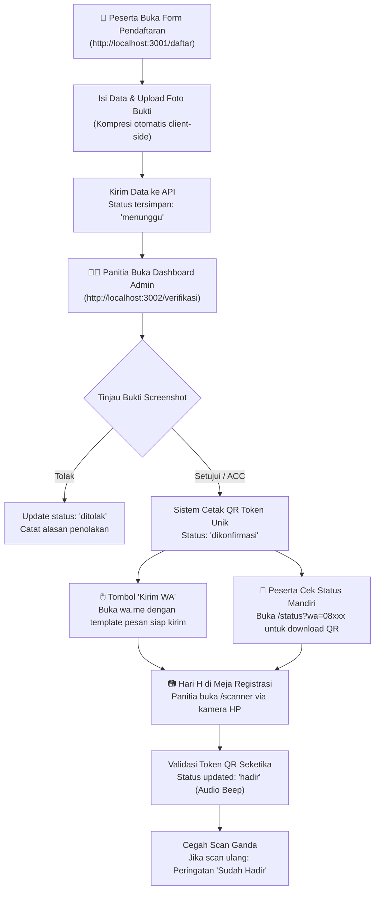

# 🌙 Muslim Scene EvenScan (MS EvenScan)

> Sistem Pendaftaran Acara Berbasis Web dengan Arsitektur Monorepo, QR Code Mandiri, dan Notifikasi WhatsApp (Gratis tanpa biaya API) di Ekosistem Cloudflare.

---

## 🌟 Arsitektur & Teknologi

| Bagian | Teknologi | Target Hosting | Deskripsi |
|---|---|---|---|
| **Backend API** | Hono + TypeScript | Cloudflare Workers | REST API, JWT Auth, Database D1, Storage R2, QR Generator |
| **Frontend Peserta** | Astro JS 5 + Tailwind CSS | Cloudflare Pages | Form pendaftaran, upload screenshot bukti, & cek tiket QR mandiri |
| **Frontend Admin** | Refine + React + Vite | Cloudflare Pages (subdomain) | Verifikasi bukti, konfirmasi berkas, tombol wa.me, & kamera scanner QR |

---

## 🚀 Panduan Memulai Cepat (Lokal Dev)

### 1. Prasyarat
- **Node.js** >= v20
- **pnpm** (disarankan)

### 2. Instalasi Dependensi
Jalankan di root folder:
```bash
pnpm install
```

### 3. Menjalankan Server Pengembangan (Dev Mode)
Anda dapat menjalankan ketiga layanan sekaligus dari root:
```bash
pnpm dev
```
Atau menjalankan per layanan:
- **Backend API**: `pnpm dev:backend` *(berjalan di `http://localhost:8787`)*
- **Situs Peserta**: `pnpm dev:peserta` *(berjalan di `http://localhost:3001`)*
- **Dashboard Admin**: `pnpm dev:admin` *(berjalan di `http://localhost:3002`)*

### 4. Menjalankan Test Suite Otomatis
Backend sudah dilengkapi dengan pengujian integrasi otomatis 10 langkah (health check, pendaftaran, cek status, login admin, konfirmasi, download QR binary, scan absensi, dan deteksi scan duplikat):
```bash
pnpm --filter backend test
```

### 5. Build Produksi
Untuk memastikan seluruh proyek dapat di-bundle tanpa error:
```bash
pnpm build
```

---

## 📱 Alur Kerja Sistem (Workflow)



---

## 🔑 Akun Default Login Admin (Development)

- **URL Dashboard Admin**: `http://localhost:3002/login`
- **Username**: `admin`
- **Password**: `admin123`

---

## ☁️ Panduan Deployment ke Cloudflare (Production)

### 1. Backend API (Cloudflare Workers)
1. Buat database D1 di Cloudflare:
   ```bash
   npx wrangler d1 create evenscan-db
   ```
   Salin `database_id` yang dihasilkan ke dalam [`backend/wrangler.toml`](backend/wrangler.toml).
2. Jalankan migrasi skema tabel ke D1 remote:
   ```bash
   npx wrangler d1 execute evenscan-db --remote --file=./src/db/schema.sql
   ```
3. Buat bucket R2 di Cloudflare:
   ```bash
   npx wrangler r2 bucket create evenscan-files
   ```
4. Deploy Worker ke Cloudflare:
   ```bash
   cd backend
   npx wrangler deploy
   ```

### 2. Frontend Peserta (Cloudflare Pages)
- **Framework Preset**: Astro
- **Build command**: `pnpm --filter peserta build`
- **Build output directory**: `frontend/peserta/dist`
- **Environment Variable**:
  - `PUBLIC_API_URL`: URL Workers API Anda (contoh: `https://api.eventanda.com`)

### 3. Frontend Admin (Cloudflare Pages — Subdomain)
- **Framework Preset**: Vite
- **Build command**: `pnpm --filter admin build`
- **Build output directory**: `frontend/admin/dist`
- **Environment Variables**:
  - `VITE_API_URL`: URL Workers API Anda
  - `VITE_SITE_URL`: URL situs peserta Anda (digunakan untuk mencetak link wa.me)

---

## 💡 Fitur Unggulan

1. **100% Bebas Biaya API WhatsApp**: Menggunakan sistem link dinamis `wa.me` dengan template pesan otomatis + halaman portal tiket mandiri yang responsif.
2. **Kompresi Gambar Otomatis**: Foto berukuran besar dari kamera HP peserta dikompresi langsung di browser sebelum dikirim, menjaga efisiensi penyimpanan R2 dan hemat bandwidth.
3. **Pencegahan Scan Ganda**: Scanner di meja registrasi memiliki sistem proteksi konflik (HTTP 409) yang memberi tahu panitia jika ada tiket yang sudah pernah digunakan.
4. **Offline-friendly Audio Beep**: Nada konfirmasi audio browser saat scan berhasil atau gagal tanpa memerlukan koneksi audio eksternal.
