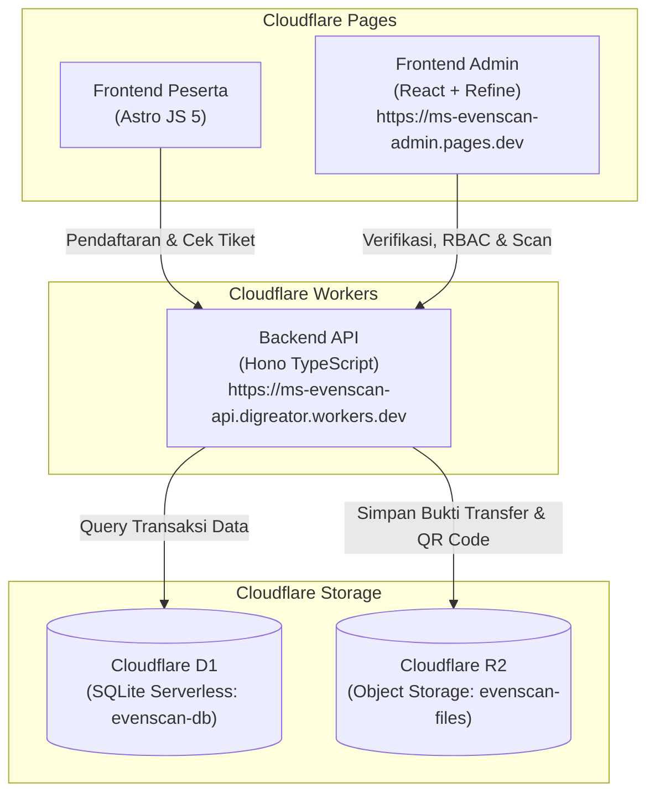

# 📋 Rencana Kerja: Koneksi Cloudflare D1, R2 & Deployment MS EvenScan

Dokumen ini memuat rencana kerja terstruktur untuk menghubungkan backend **MS EvenScan** ke database **Cloudflare D1**, penyimpanan berkas **Cloudflare R2**, serta tahapan deployment penuh ke ekosistem Cloudflare.

---

## 🏗️ 1. Arsitektur Infrastruktur

---

## 🧭 2. Tahapan Pelaksanaan (Phase Roadmap)

### **Fase 1: Koneksi & Penyediaan Cloudflare D1 & R2** *(SELESAI ✅)*
- [x] Verifikasi status otentikasi Wrangler CLI (`digreator@gmail.com`).
- [x] Buat database D1 remote di Cloudflare (`npx wrangler d1 create evenscan-db`) &mdash; ID: `a6c9a62f-eeb7-4947-b1ae-8a2b26042331`.
- [x] Buat bucket storage R2 remote di Cloudflare (`npx wrangler r2 bucket create evenscan-files`).
- [x] Perbarui `database_id` asli ke dalam file `backend/wrangler.toml`.
- [x] Jalankan migrasi skema tabel D1 (`schema.sql`): tabel `pendaftar` & `admin_users`.
- [x] Jalankan seed data akun awal admin (`seed.sql`): user `admin` (superadmin).

---

### **Fase 2: Pengujian Integrasi Database & Storage** *(SELESAI ✅)*
- [x] Uji coba eksekusi query D1 via Wrangler CLI (`SELECT * FROM admin_users` berhasil).
- [x] Verifikasi upload & delete berkas ke bucket R2 `evenscan-files` (berhasil).
- [x] Jalankan test suite integrasi backend (`npm --prefix backend run test` 10/10 skenario lolos).
- [x] Verifikasi build bundle frontend admin (`tsc && vite build` lolos).
- [x] Verifikasi build bundle frontend peserta (`astro build` lolos).

---

### **Fase 3: Deployment Backend Worker (Cloudflare Workers)** *(SELESAI ✅)*
- [x] Setup environment variable produksi di `backend/wrangler.toml`.
- [x] Deploy worker API: `npx wrangler deploy`.
- [x] Verifikasi URL produksi worker publik: `https://ms-evenscan-api.digreator.workers.dev`.
- [x] Uji endpoint `/` (Health check: `200 OK`) dan `/api/admin/login` (Login Superadmin berhasil).

---

### **Fase 4: Deployment Frontend Admin (Cloudflare Pages)** *(SELESAI ✅)*
- [x] Konfigurasikan environment variable `VITE_API_URL` mengarah ke `https://ms-evenscan-api.digreator.workers.dev`.
- [x] Tambahkan konfigurasi SPA rewrite rule `/* /index.html 200` pada `frontend/admin/public/_redirects`.
- [x] Build bundel produksi frontend admin: `npm --prefix frontend/admin run build`.
- [x] Buat project Cloudflare Pages `ms-evenscan-admin` (`--production-branch=main`).
- [x] Deploy bundel frontend admin: `https://ms-evenscan-admin.pages.dev`.
- [x] Verifikasi status respons HTTP 200 OK dan SPA deep-linking routing pada URL live Pages.

---

### **Fase 5: Deployment Frontend Peserta (Cloudflare Pages)** *(SELESAI ✅)*
- [x] Konfigurasikan environment variable `PUBLIC_API_URL` mengarah ke `https://ms-evenscan-api.digreator.workers.dev`.
- [x] Build bundel produksi frontend peserta: `npm --prefix frontend/peserta run build`.
- [x] Buat project Cloudflare Pages `ms-evenscan-peserta` (`--production-branch=main`).
- [x] Deploy frontend peserta ke Cloudflare Pages (`https://ms-evenscan-peserta.pages.dev`).
- [x] Uji alur pendaftaran peserta, upload foto bukti transfer ke R2, dan cek status tiket QR di URL live Pages (Status HTTP 200 OK & integrasi API aktif).

---

## 📊 3. Matriks Konfigurasi Resource

| Resource | Nama Resource | Binding Code | URL / ID | Keterangan |
|---|---|---|---|---|
| **Database D1** | `evenscan-db` | `DB` | `a6c9a62f-eeb7-4947-b1ae-8a2b26042331` | Tabel `pendaftar` & `admin_users` |
| **Storage R2** | `evenscan-files` | `STORAGE` | Cloudflare R2 | Bucket bukti transfer & QR Code |
| **Backend Worker** | `ms-evenscan-api` | - | `https://ms-evenscan-api.digreator.workers.dev` | Live REST API Workers |
| **Frontend Admin** | `ms-evenscan-admin` | - | `https://ms-evenscan-admin.pages.dev` | Dashboard Admin Live |
| **Frontend Peserta** | `ms-evenscan-peserta`| - | `https://ms-evenscan-peserta.pages.dev` | Web publik pendaftaran & tiket live |
